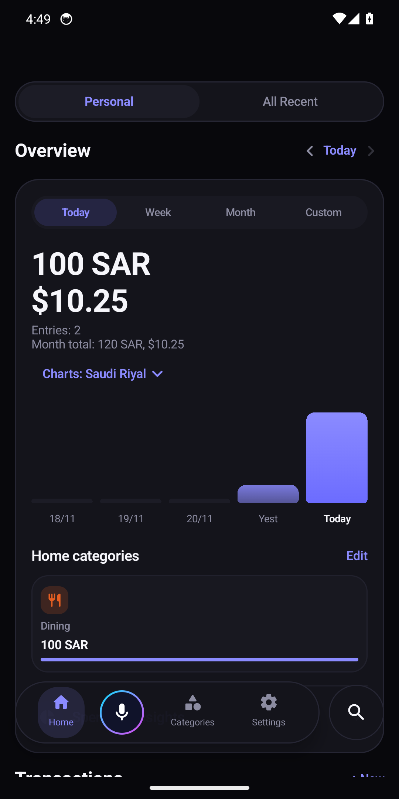

# My Expenses

[العربية](README.md) · [Privacy policy](PRIVACY_POLICY.md) · [Audit archive](docs/monavoce-audit/README.md)

My Expenses is an Android app from MONAVOCE for logging daily spending by voice or by hand. Browse your expenses by date and category, and see a separate total for each currency.

## Features

- Arabic and English expense entry, including relative dates and commands such as “How much did I spend today?”
- On-device Arabic speech recognition after importing a model. On-device English recognition depends on the device's speech service and language pack.
- Quick access from a Quick Settings tile, home screen widget, or shortcut. Side-button support depends on the device and its digital assistant settings.
- Local storage, CSV export, and JSON backups with validation and a replacement confirmation.



## Install

1. Download the signed APK from [GitHub Releases](https://github.com/AKAZA739/MONAVOCE/releases) when available. The release requires an ARM device running Android 8.0 or later.
2. For on-device Arabic, follow the [Arabic model guide](docs/arabic-model.md). In the app, choose **Settings** and **Import Offline Arabic Model (.zip)**. The verified bundle is about 106 MB.
3. For on-device English, use a language pack supported by your device's speech service. The Android on-device API requires Android 12 or later.

Online speech fallback is off by default. Manual entry is available when there is no local speech pack.

## Build

Install JDK 21 and Android SDK Platform 35. Set `JAVA_HOME` if needed, and point Android Studio or `ANDROID_HOME` to your SDK.

```sh
sh ./gradlew testDebugUnitTest lintDebug assembleDebug
```

On Windows, run `gradlew.bat` with the same tasks. See [release build and signing](docs/BUILD.md) and the [app source license](LICENSE).
