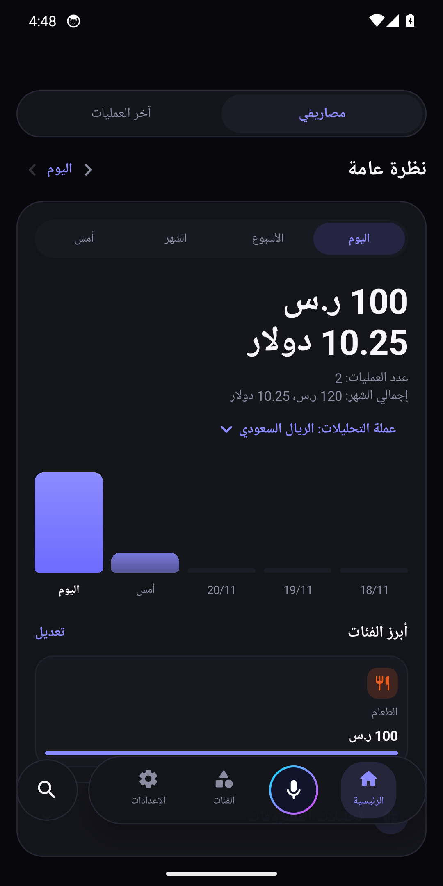
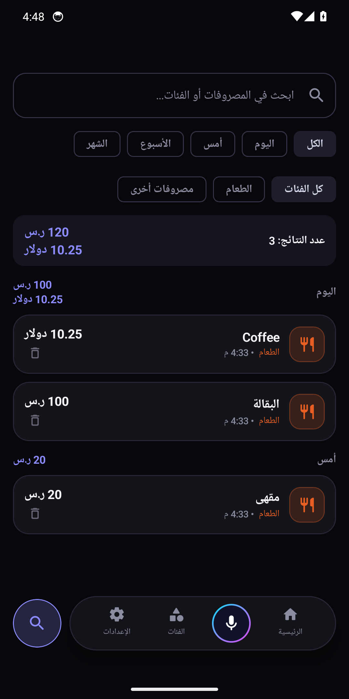

<div dir="rtl" lang="ar">

# مصاريفي — سجّل مصروفاتك بالصوت

[English](README.en.md) · [سياسة الخصوصية](PRIVACY_POLICY.md) · [سجل التدقيق](docs/monavoce-audit/README.md)

تطبيق أندرويد من مشروع MONAVOCE. قل «صرفت ٥٠ ريال على البقالة» أو أضف العملية يدويًا. تقدر بعدها تراجع مصروفاتك حسب التاريخ والفئة، وتشوف إجمالي كل عملة على حدة.

## ماذا يقدم التطبيق؟

- تسجيل المصروفات بالعربية والإنجليزية، وفهم التواريخ النسبية والأوامر مثل «كم صرفت اليوم؟».
- تعرف صوتي محلي بالعربية بعد استيراد النموذج، وبالإنجليزية على الأجهزة التي تتوفر فيها خدمة التعرف المحلية وحزمة اللغة.
- تشغيل سريع من الإعدادات السريعة أو الودجت أو اختصار الشاشة الرئيسية. يتوفر تشغيل الزر الجانبي على الأجهزة التي تدعم ربطه بالمساعد الرقمي.
- حفظ المصروفات على الجهاز، وتصدير CSV، واستعادة نسخة JSON بعد التحقق منها وتأكيد الاستبدال.

## لقطات من التطبيق

<p dir="rtl">
  
  
</p>

## التثبيت

1. افتح [صفحة الإصدارات](https://github.com/AKAZA739/MONAVOCE/releases) ونزّل ملف APK الموقّع إذا كان الإصدار متاحًا. يتطلب الإصدار جهاز ARM يعمل بأندرويد 8.0 أو أحدث.
2. للتعرف المحلي بالعربية، جهّز ملف ZIP للنموذج حسب [دليل النموذج العربي](docs/arabic-model.md). افتح **الإعدادات** ثم **استيراد نموذج العربية المحلي (.zip)** واختر الملف. حجم الحزمة التي اختُبرت حوالي 106 MB.
3. للتعرف المحلي بالإنجليزية، استخدم حزمة لغة تدعمها خدمة التعرف على جهازك. يتطلب مسار Android المحلي أندرويد 12 أو أحدث.
4. تشغيل الزر الجانبي يعتمد على الجهاز وإصدار النظام. إذا ظهر خيار **المساعد الرقمي** ضمن إعدادات الزر، اختر مصاريفي كمساعد افتراضي ثم اربط الضغط المطوّل به.

البديل السحابي مغلق افتراضيًا. تقدر تستخدم الإدخال اليدوي مباشرة إذا كانت حزمة الصوت المحلية غير متوفرة.

## البناء والاختبار

تحتاج JDK 21 وحزمة Android SDK Platform 35. اضبط `JAVA_HOME` على مسار JDK عندك إذا احتجت، وحدد مسار Android SDK عبر Android Studio أو `ANDROID_HOME`.

**Windows**

<div dir="ltr">

```powershell
.\gradlew.bat testDebugUnitTest lintDebug assembleDebug
```

</div>

**macOS وLinux**

<div dir="ltr">

```sh
sh ./gradlew testDebugUnitTest lintDebug assembleDebug
```

</div>

راجع [دليل بناء الإصدار وتوقيعه](docs/BUILD.md) و[ترخيص كود التطبيق](LICENSE).

</div>
