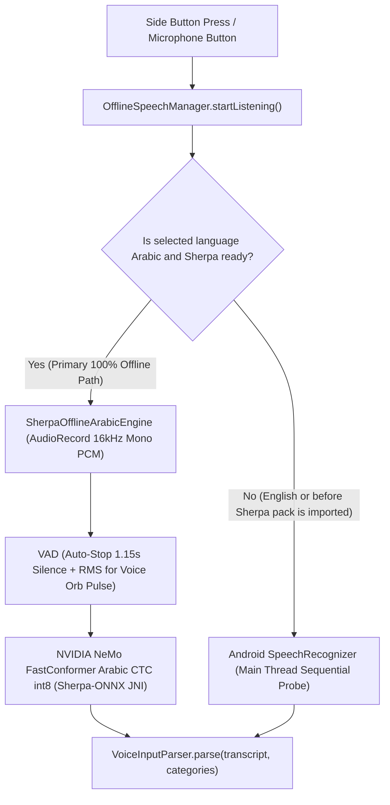

# 04 — Offline Voice Recognition & Android Hardware Quick-Launch Audit

This report documents the engineering and real-device inspection of the **Offline Speech-to-Text** architecture, the **Voice NLP Parser**, and **Side/Power Button Quick-Launch** integrations on a **Samsung Galaxy A54 5G (`SM-A546E`)**.

---

## 1. Hybrid Offline ASR Architecture

Real-device testing on the **Samsung Galaxy A54 5G (Android 16 / One UI 8.5)** confirmed that Google's built-in system recognizer (`com.google.android.as` / `AiAiSpeechRecognitionService`) supports 30 offline languages—none of which include Arabic (`ar-*`)—and threw `ERROR_SERVER_DISCONNECTED (11)` or `ERROR_LANGUAGE_UNAVAILABLE (12)` when forcing offline Arabic recognition.

To solve this limitation at its root, the app implements a dual-engine architecture in [OfflineSpeechManager.kt](../../app/src/main/java/com/myexpenses/app/voice/OfflineSpeechManager.kt) and [SherpaOfflineArabicEngine.kt](../../app/src/main/java/com/myexpenses/app/voice/SherpaOfflineArabicEngine.kt):



### Engineering Characteristics of `SherpaOfflineArabicEngine`:
1. **Neural Model:** `NVIDIA NeMo FastConformer-Transducer-Large Arabic (Gulf + MSA)` quantized to `int8 ONNX` (`encoder.int8.onnx` ~115 MB, `decoder.int8.onnx` ~7.5 MB, `joiner.int8.onnx` ~1.7 MB, `tokens.txt`).
2. **Audio Capture & Real-Time RMS Meter:** Records `16,000 Hz` mono audio (`PCM 16-bit`) and computes normalized root-mean-square energy (`computeNormalizedRms` at lines [295-309](../../app/src/main/java/com/myexpenses/app/voice/SherpaOfflineArabicEngine.kt)) to animate the neon rings in `VoiceOverlayPanel` in real-time sync with the user's voice.
3. **Smart Auto-Stop VAD:** Detects speech onset when audio exceeds `SPEECH_START_RMS_THRESHOLD = 0.16f` and automatically stops recording after `SILENCE_DURATION_TO_STOP_MS = 1150L` ms of continuous silence (lines [218-246](../../app/src/main/java/com/myexpenses/app/voice/SherpaOfflineArabicEngine.kt)).
4. **Measured Performance on Samsung A54 5G:**
   - Cold engine initialization in memory (`ensureRecognizer`): **`1,150ms – 1,368ms`** (one-time cost).
   - Full Arabic sentence decode latency (`decodeMs`) for 3–5 seconds of speech: **`179ms – 252ms`** across 4 CPU threads (`numThreads = 4`) in full Flight Mode!

---

## 2. Voice NLP Parser Audit (`VoiceInputParser` & `NumberWordParser`)

Inspected [VoiceInputParser.kt](../../app/src/main/java/com/myexpenses/app/domain/parser/VoiceInputParser.kt) and [NumberWordParser.kt](../../app/src/main/java/com/myexpenses/app/domain/parser/NumberWordParser.kt), and executed the automated test suite ([VoiceInputParserTest.kt](../../app/src/test/java/com/myexpenses/app/VoiceInputParserTest.kt)):

### A. Verified Supported Capabilities (16/16 Unit Tests Passing)
- **Arabic, Eastern Arabic/Persian, and Compound Number-Word Conversion:**
  - Eastern Arabic and Persian digits.
  - Compound Arabic numbers, including 150, 2,500, 3,250, 17,000, and fractions such as half a riyal.
  - English number words: `"twenty five"` -> `25`, `"one hundred fifty"` -> `150`.
- **Multi-Expense Clause Splitting:**
  - The Arabic equivalent of "lunch 2500 and petrol 4000 and coffee 800" parses and saves as **3 independent transactions** in `Food & Drink`, `Transport & Fuel`, and `Food & Drink`.
- **Administrative Voice Commands:**
  - Delete: `"delete last expense"` -> `VoiceCommandResult.DeleteLastExpense`.
  - Update: `"update last expense to 45 taxi"` -> `VoiceCommandResult.UpdateLastExpense`.
- **Weighted Keyword Scoring:**
  - Awards `+10` points (plus a keyword-length bonus) for exact word matches and `+4` points for partial matches, backed by a broad Arabic dialect synonym dictionary in [CategoryEntity.kt](../../app/src/main/java/com/myexpenses/app/data/local/entity/CategoryEntity.kt) (covering terms such as dinner, lunch, breakfast, shawarma, restaurant, café, coffee, qat, petrol, diesel, bus, taxi, Careem, Uber, pharmacy, medicine, barber, rent, internet, phone credit, etc.).

### B. Discovered Voice Parser Edge Cases

#### 1. `[MONA-VOX-001]` (Medium) — Single Expense Split into Two When Item Name Includes a Quantity Number Followed by a Price Without a Conjunction
- **Exact Location:** [VoiceInputParser.kt](../../app/src/main/java/com/myexpenses/app/domain/parser/VoiceInputParser.kt) (`splitIntoExpenseClauses`).
- **Evidence & Root Cause:** In an Arabic utterance meaning "I bought 2 milk for 1000 riyals", `NumberWordParser.replaceNumberWordsWithDigits` strips or separates the preposition for the price. `splitIntoExpenseClauses` sees two numbers (`2` and `1000`) separated by the item name and creates **two separate expenses**:
  1. First expense: `2` — Note: "milk" (translated), categorized as Food & Drink.
  2. Second expense: `1000` — Note: `"Other expenses"`!
- **Recommended Fix:** In `splitIntoExpenseClauses`, when a small leading quantity (`<= 12`) is followed by an item noun, a price preposition such as "for" or "at", and the actual price, merge the quantity into the item note and treat the second number (`1000`) as the sole expense amount.

#### 2. `[MONA-VOX-002]` (Medium) — `"Update Last Expense"` Command Fails When Changing Only Category or Note Without a New Amount
- **Exact Location:** [VoiceInputParser.kt](../../app/src/main/java/com/myexpenses/app/domain/parser/VoiceInputParser.kt):
  ```kotlin
  if (matchesAny(lower, UPDATE_LAST_PATTERNS)) {
      val cleaned = stripCommandPhrases(normalized, UPDATE_LAST_PATTERNS)
      val amount = extractFirstAmount(cleaned)
      if (amount != null && amount > 0.0) { ... }
  }
  ```
- **Evidence:** The `if (amount != null && amount > 0.0)` check forces the user to speak a new monetary amount when updating the last expense. The Arabic command for "update last expense to transport" fails when changing only the category and returns `VoiceCommandResult.Unclear`.
- **Recommended Fix:** Make `newAmount: Double?` nullable in `UpdateLastExpense` so that omitting an amount preserves the last expense's existing amount and updates only its category and/or note.

#### 3. `[MONA-VOX-003]` (Medium) — Eager Preloading of `130 MB` Sherpa-ONNX Model in `Application.onCreate()` Even on Background Widget Updates
- **Exact Location:** [MyExpensesApp.kt](../../app/src/main/java/com/myexpenses/app/MyExpensesApp.kt):
  ```kotlin
  override fun onCreate() {
      super.onCreate()
      container = AppContainer(this)
      container.sherpaArabicEngine.warmUpAsync()
  }
  ```
- **Impact:** Android instantiates `MyExpensesApp` and runs `onCreate()` even when waking the process briefly in the background to refresh the home screen widget (`ExpenseWidgetProvider.onUpdate`). Unconditional `warmUpAsync()` loads 130 MB of ONNX weights into native heap (`~220 MB` RSS) with no voice input needed!
- **Recommended Fix:** Move `warmUpAsync()` so it is invoked only when opening `MainActivity`, `QuickVoiceActivity`, or `ExpenseVoiceInteractionSessionService` rather than in `Application.onCreate()`.

---

## 3. Side/Power Button Quick-Launch & Hardware Integration Audit

All quick-launch mechanisms were tested on the **Samsung Galaxy A54 5G (`SM-A546E` — One UI 8.5 / Android 16)**:

| Launch Mechanism | Status & Support on Samsung A54 5G | Engineering Details (`[MONA-VOX-004]`) |
|---|---|---|
| **1. Long-Press Side Button (`Press & Hold Side Button`)** | **100% Supported & Working** | Via `ExpenseVoiceInteractionService` and `QuickVoiceActivity` (`ACTION_ASSIST`). Preserves **Double Press** for the Camera as preferred, and opens the voice capture sheet directly over any app. |
| **2. Double-Press Side Button (`Double Press Side Button`)** | **100% Supported & Working** | Via `Settings -> Advanced features -> Side button -> Double press -> Open app`, or via a pinned voice shortcut (`QuickLaunchHelper.requestPinVoiceShortcut`). |
| **3. Triple-Press Power Button (`Triple Press Power Button`)** | **Android/One UI OS Limitation (`MONA-VOX-004`)** | Android 16 and One UI 8.5 do not expose a public API for triple-pressing the power key (2x is reserved for Camera/App, long-press for Assistant/Power off, 5x for Emergency SOS). The official alternatives that leave Camera untouched are **Long-Press as Digital Assistant** or **RegiStar Back-Tap**. |
| **4. Launch Over Lock Screen (`Lock Screen Launch`)** | **Supported & Working** | Uses `setShowWhenLocked(true)`, `setTurnScreenOn(true)`, and `FLAG_KEEP_SCREEN_ON` in [QuickVoiceActivity.kt](../../app/src/main/java/com/myexpenses/app/quicklaunch/QuickVoiceActivity.kt). |
| **5. Duplicate Session & Battery Drain Prevention** | **Supported & Protected** | Activity uses `android:launchMode="singleTop"` and `excludeFromRecents="true"`, and calls `viewModel.cancelVoiceInput()` in `onStop()` (line 90) to immediately release the microphone when the screen turns off or the user exits. |
