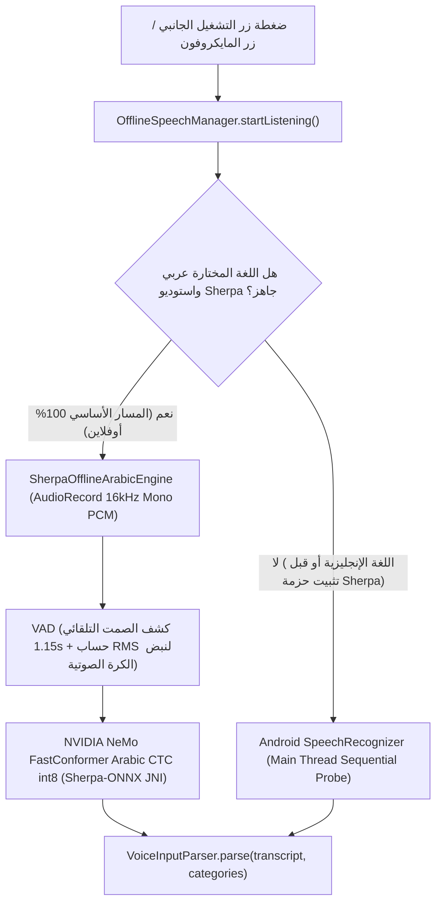

<div dir="rtl" lang="ar">

# 04 — تدقيق محرك التعرف الصوتي الأوفلاين والتشغيل السريع عبر أزرار الهاتف (Voice Recognition & Android Quick-Launch Audit)

يوثق هذا التقرير الفحص الهندسي والعملي لمنظومة التعرف الصوتي بدون إنترنت (**Offline Speech-to-Text**)، ومحلل اللغة الطبيعية للمصاريف (**Voice NLP Parser**)، وآليات التشغيل السريع عبر زر التشغيل الجانبي (**Side/Power Button**) على هاتف **Samsung Galaxy A54 5G (`SM-A546E`)**.

---

## 1. معمارية التعرف الصوتي الهجينة بدون إنترنت (Hybrid Offline ASR Architecture)

أثبت الفحص العملي على هاتف **Samsung Galaxy A54 5G (Android 16 / One UI 8.5)** أن محرك جوجل المدمج في النظام (`com.google.android.as` / `AiAiSpeechRecognitionService`) يدعم 30 لغة أوفلاين ليس من بينها أي حزمة للغة العربية (`ar-*`)، وكان يرمي الخطأ `ERROR_SERVER_DISCONNECTED (11)` أو `ERROR_LANGUAGE_UNAVAILABLE (12)` عند محاولة فرض التعرف العربي بدون إنترنت.

ولحل هذا القيد جذريًا، يطبق التطبيق معمارية ثنائية المحرك في [OfflineSpeechManager.kt](../../app/src/main/java/com/myexpenses/app/voice/OfflineSpeechManager.kt) و [SherpaOfflineArabicEngine.kt](../../app/src/main/java/com/myexpenses/app/voice/SherpaOfflineArabicEngine.kt):



### الخصائص الهندسية لمحرك `SherpaOfflineArabicEngine`:
1. **النموذج العصبي:** `NVIDIA NeMo FastConformer-Transducer-Large Arabic (Gulf + MSA)` محول إلى صيغة `int8 ONNX` (`encoder.int8.onnx` ~115 MB، `decoder.int8.onnx` ~7.5 MB، `joiner.int8.onnx` ~1.7 MB، `tokens.txt`).
2. **التقاط الصوت ومؤشر الطاقة اللحظي (`RMS Meter`):** يسجل الصوت بتردد `16,000 Hz` أحادي القناة (`PCM 16-bit`) ويحسب الجذر التربيعي المتوسط للطاقة الصوتية (`computeNormalizedRms` في الأسطر [295-309](../../app/src/main/java/com/myexpenses/app/voice/SherpaOfflineArabicEngine.kt)) لتحريك حلقات النيون في `VoiceOverlayPanel` بتزامن حقيقي مع نبرة صوت المستخدم.
3. **التوقف التلقائي الذكي عند الصمت (`Auto-Stop VAD`):** يكتشف بداية الكلام عندما يتجاوز مستوى الصوت `SPEECH_START_RMS_THRESHOLD = 0.16f`، وينهي التسجيل تلقائيًا بعد صمت مستمر لمدة `SILENCE_DURATION_TO_STOP_MS = 1150L` مللي ثانية (الأسطر [218-246](../../app/src/main/java/com/myexpenses/app/voice/SherpaOfflineArabicEngine.kt)).
4. **السرعة الفعلية المقاسة على Samsung A54 5G:**
   - تهيئة المحرك في الذاكرة (`ensureRecognizer`): **`1,150ms – 1,368ms`** (تتم مرة واحدة فقط).
   - فك تشفير جملة عربية كاملة مدتها 3–5 ثوانٍ (`decodeMs`): **`179ms – 252ms`** فقط على،4 أنوية معالج (`numThreads = 4`) في وضع الطيران الكامل!

---

## 2. تدقيق محلل اللغة الطبيعية للمصاريف (`VoiceInputParser` & `NumberWordParser`)

تم فحص [VoiceInputParser.kt](../../app/src/main/java/com/myexpenses/app/domain/parser/VoiceInputParser.kt) و [NumberWordParser.kt](../../app/src/main/java/com/myexpenses/app/domain/parser/NumberWordParser.kt) وتشغيل حزمة الاختبارات الآلية ([VoiceInputParserTest.kt](../../app/src/test/java/com/myexpenses/app/VoiceInputParserTest.kt)):

### أ. القدرات المدعومة بنجاح (16/16 Unit Tests Passing)
- **تحويل الأرقام العربية والهندية واللفظية المركبة:**
  - الأرقام الهندية والفارسية (`٠١٢٣٤٥٦٧٨٩` / `۰۱۲۳۴۵۶۷۸۹`).
  - الألفاظ المركبة: `"مئة وخمسين"` -> `150`، `"ألفين وخمسمئة"` -> `2500`، `"ثلاثة آلاف ومئتين وخمسين"` -> `3250`، `"سبعة عشر ألف"` -> `17000`، `"نصف ريال"` / `"ونص"` -> `+0.5`.
  - الألفاظ الإنجليزية: `"twenty five"` -> `25`، `"one hundred fifty"` -> `150`.
- **فصل الجمل المتعددة في أمر صوتي واحد (`Multi-Expense Clause Splitting`):**
  - مثال: `"غداء 2500 وبنزين 4000 وقهوة 800"` -> يتم تحليلها وحفظها كـ **3 معاملات مستقلة**، كل معاملة في فئتها الصحيحة (`الطعام والشراب`، `المواصلات والوقود`، `الطعام والشراب`).
- **الأوامر الصوتية الإدارية:**
  - الحذف: `"احذف آخر مصروف"` / `"التراجع عن آخر عملية"` / `"delete last expense"` -> `VoiceCommandResult.DeleteLastExpense`.
  - التعديل: `"عدل آخر مصروف إلى 3000 غداء"` / `"update last expense to 45 taxi"` -> `VoiceCommandResult.UpdateLastExpense`.
- **التصنيف الذكي الموزون (`Weighted Keyword Scoring`):**
  - يمنح التطابق الكامل للكلمة `+10` نقاط مع مكافأة لطول الكلمة المفتاحية، والتطابق الجزئي `+4` نقاط، مع قاموس مرادفات واسع للهجات العربية في [CategoryEntity.kt](../../app/src/main/java/com/myexpenses/app/data/local/entity/CategoryEntity.kt) (مثل: `عشاء، غداء، فطور، شاورما، مطعم، بوفية، قهوة، قات، بترول، ديزل، باص، تاكسي، كريم، أوبر، صيدلية، علاج، حلاق، إيجار، نت، رصيد...`).

### ب. حالات الحافة المكتشفة في المحلل اللغوي (Voice Parser Edge Cases)

#### 1. `[MONA-VOX-001]` (Medium) — تقسيم المصروف الواحد إلى مصروفين إذا احتوى اسم السلعة على رقم كمية أو موديل بدون حرف عطف
- **الموقع الدقيق:** [VoiceInputParser.kt](../../app/src/main/java/com/myexpenses/app/domain/parser/VoiceInputParser.kt) (`splitIntoExpenseClauses`).
- **الدليل والسبب الجذري:** إذا قال المستخدم `"اشتريت 2 حليب ب 1000 ريال"`، فإن `NumberWordParser.replaceNumberWordsWithDigits` يحذف حرف الجر `"ب"` الملتصق أو يفصل الأرقام، ثم ترى الدالة `splitIntoExpenseClauses` رقمين منفصلين (`2` و`1000`) بينهما كلمة غير رقمية (`"حليب"`) فتعتبرهما **جملتين منفصلتين** وتنتج مصروفين:
  1. المصروف الأول: `2 ريال` — الملاحظة: `"حليب"` (الطعام والشراب).
  2. المصروف الثاني: `1000 ريال` — الملاحظة: `"مصروفات أخرى"`!
- **الإصلاح المقترح:** في `splitIntoExpenseClauses`، إذا كان الرقم الأول رقمًا صغيرًا للكمية (`<= 12`) متبوعًا باسم سلعة ثم حرف جر سعري (`ب` / `بـ` / `بسعر` / `بمبلغ` / `for` / `at`) متبوعًا بالمبلغ الحقيقي، يتم دمج الكمية مع اسم السلعة (`"2 حليب"`) واعتماد الرقم الثاني (`1000`) كمبلغ وحيد للمصروف.

#### 2. `[MONA-VOX-002]` (Medium) — أمر `"عدل آخر مصروف"` يفشل إذا أراد المستخدم تعديل الفئة أو الملاحظة فقط دون ذكر مبلغ جديد
- **الموقع الدقيق:** [VoiceInputParser.kt](../../app/src/main/java/com/myexpenses/app/domain/parser/VoiceInputParser.kt):
  ```kotlin
  if (matchesAny(lower, UPDATE_LAST_PATTERNS)) {
      val cleaned = stripCommandPhrases(normalized, UPDATE_LAST_PATTERNS)
      val amount = extractFirstAmount(cleaned)
      if (amount != null && amount > 0.0) { ... }
  }
  ```
- **الدليل:** الشرط `if (amount != null && amount > 0.0)` يلزم المستخدم بنطق مبلغ مالي جديد عند تعديل آخر مصروف. إذا قال المستخدم `"عدل آخر مصروف إلى المواصلات"` لتصحيح الفئة فقط، يفشل الشرط ويرجع `VoiceCommandResult.Unclear`.
- **الإصلاح المقترح:** السماح بأن يكون `newAmount: Double?` قابلاً للقيمة الفارغة (`null`) في `UpdateLastExpense` بحيث إذا لم يُذكر مبلغ جديد يتم الاحتفاظ بمبلغ المصروف الأخير وتحديث الفئة و/أو الملاحظة فقط.

#### 3. `[MONA-VOX-003]` (Medium) — التحميل المسبق لنموذج Sherpa-ONNX (`130 MB`) في `Application.onCreate()` حتى عند استيقاظ التطبيق في الخلفية لتحديث الودجت
- **الموقع الدقيق:** [MyExpensesApp.kt](../../app/src/main/java/com/myexpenses/app/MyExpensesApp.kt):
  ```kotlin
  override fun onCreate() {
      super.onCreate()
      container = AppContainer(this)
      container.sherpaArabicEngine.warmUpAsync()
  }
  ```
- **الأثر:** نظام أندرويد ينشئ كائن `MyExpensesApp` ويشغل `onCreate()` حتى عندما يستيقظ التطبيق في الخلفية لمدة ثانية واحدة لتحديث ودجت الشاشة الرئيسية (`ExpenseWidgetProvider.onUpdate`). استدعاء `warmUpAsync()` غير المشروط يقوم بتحميل 130 ميغابايت من ملفات ONNX إلى الذاكرة الأصلية (`Native Heap ~220 MB`) بدون أي حاجة للصوت!
- **الإصلاح المقترح:** نقل `warmUpAsync()` ليُستدعى فقط عند فتح `MainActivity` أو `QuickVoiceActivity` أو `ExpenseVoiceInteractionSessionService` بدلاً من `Application.onCreate()`.

---

## 3. تدقيق التشغيل السريع عبر زر التشغيل الجانبي (Side/Power Button & Hardware Integration)

تم فحص جميع طرق التشغيل السريع على هاتف **Samsung Galaxy A54 5G (`SM-A546E` — One UI 8.5 / Android 16)**:

| آلية التشغيل | حالة التنفيذ والدعم على Samsung A54 5G | التفاصيل الهندسية (`[MONA-VOX-004]`) |
|---|---|---|
| **1. الضغط المطول على زر التشغيل الجانبي (`Press & Hold Side Button`)** | **مدعوم ويعمل رسميًا 100%** | عبر تسجيل `ExpenseVoiceInteractionService` و`QuickVoiceActivity` (`ACTION_ASSIST`). يحافظ هذا الخيار على **الضغطتين السريعتين (`Double Press`) للكاميرا** كما يفضل المستخدم، ويفتح نافذة التسجيل الصوتي مباشرة فوق أي تطبيق. |
| **2. الضغط مرتين على زر التشغيل الجانبي (`Double Press Side Button`)** | **مدعوم ويعمل رسميًا 100%** | من خلال `Settings -> Advanced features -> Side button -> Double press -> Open app`، أو عبر إنشاء اختصار مباشر من داخل التطبيق (`QuickLaunchHelper.requestPinVoiceShortcut`). |
| **3. الضغط 3 مرات على زر التشغيل (`Triple Press Power Button`)** | **قيد نظام أندرويد/One UI (`MONA-VOX-004`)** | نظام Android 16 وواجهة One UI 8.5 لا يوفران واجهة برمجية عامة لثلاث ضغطات على زر الباور (لأن 2x للكاميرا/التطبيق، والضغط المطول للمساعد/إيقاف التشغيل، و5x لطوارئ SOS). البديل الرسمي لعدم المساس بالكاميرا هو **الضغط المطول كمساعد رقمي** أو **RegiStar Back-Tap**. |
| **4. التشغيل والشاشة مقفلة (`Lock Screen Launch`)** | **مدعوم ويعمل** | يستخدم `setShowWhenLocked(true)` و`setTurnScreenOn(true)` و`FLAG_KEEP_SCREEN_ON` في [QuickVoiceActivity.kt](../../app/src/main/java/com/myexpenses/app/quicklaunch/QuickVoiceActivity.kt). |
| **5. منع تكرار الجلسات واستنزاف البطارية** | **مدعوم ومحمـي** | النشاط معرف بـ `android:launchMode="singleTop"` و`excludeFromRecents="true"`، وفي `onStop()` (السطر 90) يستدعي `viewModel.cancelVoiceInput()` لإغلاق الميكروفون فورًا عند إطفاء الشاشة أو الخروج. |

</div>
