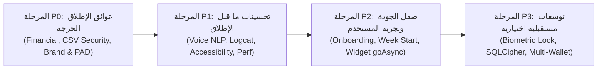

# 10 — خارطة طريق الإصلاح والتحول إلى MONAVOCE (Prioritized Remediation Roadmap)

تحدد خارطة الطريق هذه الترتيب الهندسي الدقيق لمعالجة الملاحظات المسجلة في [09-findings-register.md](file:///d:/My%20expensives/docs/monavoce-audit/09-findings-register.md) وتحويل التطبيق إلى إصدار الإنتاج العالمي **MONAVOCE v2.0.0**.

---

## نظرة عامة على مراحل التنفيذ

---

## المرحلة الأولى: `P0` — عوائق الإطلاق الإلزامية (Release Blockers — Must Fix Before Play Store Launch)

| الترتيب | المعرف (Finding ID) | المهمة الهندسية | درجة التعقيد | الاعتماديات | معيار القبول النهائي (Acceptance Criteria) |
|---|---|---|---|---|---|
| **1** | `MONA-FIN-002` | تغليف `replaceAllFromBackup` داخل `database.withTransaction` والتحقق المسبق من الفئات والمبالغ في `BackupManager.restoreJsonBackup`. | **Low** (1–2 ساعة) | لا يوجد | استعادة ملف JSON يحتوي على فئة غير موجودة أو مبلغ تالف لا تمسح البيانات الحالية أو تعيد تعيين الفئة بأمان إلى `"other"` ذريًا. |
| **2** | `MONA-FIN-001` + `MONA-FIN-003` | تصفية إجماليات لوحة التحكم والإحصائيات والودجت حسب العملة النشطة `preferences.currency.code`، وعرض رمز عملة السجل الحقيقية في البطاقات، وتقريب المبالغ عبر `BigDecimal` (منزلتين عشريتين). | **Medium** (2–3 ساعات) | الخطوة 1 | عدم جمع عملتين مختلفتين (`YER` + `USD`) في رقم واحد، وعرض كل معاملة برمز عملتها الصحيح، وخلو JSON من كسور الفاصلة العائمة الطويلة. |
| **3** | `MONA-SEC-001` | تحصين `BackupManager.csvEscape` ضد حقن المعادلات (`=`, `+`, `-`, `@`, `\t`, `\r`) بإضافة `'` بادئة. | **Low** (30 دقيقة) | لا يوجد | اجتياز اختبارات الوحدة لتصدير نصوص تبدأ بـ `=` و`-` و`+` و`@` بأمان في Excel. |
| **4** | `MONA-PLAY-001` | تطبيق هوية **MONAVOCE (موناڤوتشي)**: تحويل الحزمة إلى `com.monavoce.app`، تحديث الاسم والأيقونة التكيفية وشاشة البداية ونظام ألوان `Obsidian Vault` / `Alabaster Prestige`. | **Medium** (3–4 ساعات) | مواصفات `06-brand-identity.md` | بناء التطبيق بنجاح تحت معرف `com.monavoce.app` وظهور اسم وشعار **MONAVOCE** في اللانشر والترويسة والإعدادات. |
| **5** | `MONA-PLAY-002` | إنشاء وحدة Play Asset Delivery (`:arabic_asr_pack` من نوع `install-time`) لتضمين نموذج Sherpa-ONNX العربي (`130 MB`) داخل حزمة `.aab` بدون إنترنت. | **Medium** (2–3 ساعات) | الخطوة 4 | توليد ملف `monavoce-release.aab` يحتوي على النموذج الصوتي ويعمل أوفلاين فور التثبيت دون طلب ملف ZIP خارجي. |

---

## المرحلة الثانية: `P1` — تحسينات عالية الأولوية قبل النشر العام (High-Priority Pre-Release Fixes)

| الترتيب | المعرف (Finding ID) | المهمة الهندسية | درجة التعقيد | الاعتماديات | معيار القبول النهائي (Acceptance Criteria) |
|---|---|---|---|---|---|
| **6** | `MONA-SEC-002` + `MONA-SEC-005` | فرض سقف حجم لفك ضغط ZIP (`150 MB` للملف) وقراءة JSON (`15 MB`)، وجعل `context.filesDir` المسار الأساسي لتخزين النموذج المستورد. | **Low** (1 ساعة) | لا يوجد | رفض ملفات الاستيراد المتضخمة بأمان، وحفظ النموذج المستورد في `/data/data/com.monavoce.app/files/`. |
| **7** | `MONA-SEC-004` | إزالة طباعة النصوص الصوتية المنطوقة من `Log.i` في `OfflineSpeechManager` و`SherpaOfflineArabicEngine` وإضافة قواعد تجريد `Log` في `proguard-rules.pro`. | **Low** (30 دقيقة) | لا يوجد | خلو `adb logcat` في نسخة `Release` من أي جملة ينطقها المستخدم. |
| **8** | `MONA-SEC-003` + `MONA-PLAY-003` | تقييد السلوك التلقائي في `QuickVoiceActivity` عند الاستدعاء الخارجي (منع الحذف الصوتي التلقائي بدون تأكيد)، ومراجعة `ExpenseStubRecognitionService`. | **Low** (1 ساعة) | لا يوجد | أمان كامل للنشاط المصدر عند فحصه بأدوات فحص الـ Intents. |
| **9** | `MONA-VOX-001` + `MONA-VOX-002` | تطوير `VoiceInputParser` لدمج رقم الكمية مع السلعة (`"اشتريت 2 حليب ب 1000"`)، والسماح بتعديل الفئة وحدها في `"عدل آخر مصروف إلى المواصلات"`. | **Medium** (2 ساعة) | لا يوجد | ارتفاع اختبارات الوحدة في `VoiceInputParserTest` من 16 إلى **24+ اختبارًا ناجحًا 100%**. |
| **10** | `MONA-VOX-003` + `MONA-PERF-001` | نقل `warmUpAsync()` من `Application.onCreate()` إلى أنشطة الواجهة، وتشغيل حسابات `MainViewModel.dashboardState` على `Dispatchers.Default`. | **Low** (1.5 ساعة) | لا يوجد | عدم تحميل النموذج (`130 MB`) عند تحديث الودجت في الخلفية، وسلاسة التمرير مع آلاف السجلات. |
| **11** | `MONA-FIN-004` + `MONA-FIN-005` | إضافة `@ColumnInfo(defaultValue = "other")` في `ExpenseEntity`، وتفعيل `exportSchema = true` في `ExpenseDatabase`. | **Low** (1 ساعة) | الخطوة 4 | تصدير ملف المخطط `1.json` تلقائيًا في مجلد `app/schemas/`. |
| **12** | `MONA-UX-001` + `MONA-UX-002` | دعم الوضع النهاري في `VoiceOverlayPanel`، وإضافة `contentDescription` لكافة عناصر التحكم وتكبير أزرار الحذف والتاريخ إلى `48.dp`. | **Medium** (2–3 ساعات) | الخطوة 4 | توافق كامل مع TalkBack والوضع النهاري `Alabaster Prestige`. |

---

## المرحلة الثالثة: `P2` — صقل الجودة وتجربة المستخدم (Quality & Design Polish)

1. **`MONA-UX-003` (شاشة الترحيب التفاعلية — MONAVOCE Onboarding):** بطاقة ترحيبية أنيقة من 3 خطوات عند التشغيل الأول تعرض أمثلة الأوامر الصوتية وزر تفعيل اختصار زر التشغيل الجانبي.
2. **`MONA-FIN-006` (تخصيص بداية الأسبوع):** خيار في الإعدادات لاختيار أول أيام الأسبوع (`السبت / الأحد / الإثنين`) وتحديث تلقائي لتاريخ اليوم عند منتصف الليل.
3. **`MONA-ARCH-001` + `MONA-SEC-006`:** استخدام `goAsync()` في `ExpenseWidgetProvider`، وإلزام فشل بناء `Release` في CI إذا لم يتوفر ملف التوقيع الرسمي.
4. **إضافة صفحة سياسة الخصوصية المحلية والرابط الخارجي (`Privacy Policy Screen & URL`):** داخل شاشة الإعدادات لتلبية متطلبات Google Play.

---

## المرحلة الرابعة: `P3` — ميزات مستقبلية اختيارية للإصدارات اللاحقة (Future Enhancements v2.1+)

1. **قفل الخزنة بالبصمة (`Biometric Vault Lock`):** حماية فتح التطبيق عبر `BiometricPrompt` (بصمة الإصبع أو الوجه) مع تشفير اختياري لقاعدة البيانات عبر `SQLCipher`.
2. **الميزانيات الشهرية والتنبيهات الصوتية (`Smart Budgets`):** تحديد سقف إنفاق شهري لكل فئة مع شريط تقدم تحذيري.
3. **تعدد المحافظ/الحسابات (`Personal vs. Business Wallets`):** التبديل بين محفظة شخصية ومحفظة عمل في أعلى لوحة التحكم.
